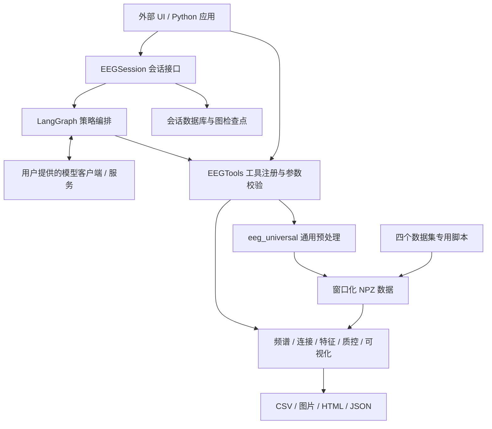

# EEG-Agent Core 中文说明

[English](README.md) | [可视化使用指南](docs/visualization.zh-CN.md)

EEG-Agent Core 是一个可独立使用的脑电科研处理库，提供原始 EEG 预处理、质量检查、频谱分析、功能连接、手工特征和可视化报告，并可通过 LangGraph 接入大模型组织分析流程。

当前版本：**0.4.1**。需要 **Python 3.11 或更新版本**，采用 MIT 许可证。

科学工具可以直接从 Python 调用，不需要大模型。项目不包含 Web 应用、聊天终端、vLLM 服务或模型权重；交互界面由独立的 EEG-Agent-UI 项目提供。分析结果用于科研描述，不构成临床诊断。

## 文档导航

| 文档 | 内容 |
| --- | --- |
| 本文 | 安装、架构、预处理、工具 API、Agent 接入 |
| [中文可视化指南](docs/visualization.zh-CN.md) | `eeg_visualization.py`、17 种图、参数、报告与结果解读 |
| [手工特征说明](README_FEATURES.md) | 特征定义、单位和频段设置，英文 |
| [运行时接口](README_RUNTIME.md) | 流式事件、审批和恢复，英文 |
| [0.4.0 扩展](README_V040.md) | 批处理、连接分析、缓存和执行策略，英文 |
| [质控与元数据](README_QC_METADATA.md) | 处理前后配对比较及输出元数据，英文 |

## 安装

在仓库根目录、已选定的 Python 环境中执行以下命令。Windows、Linux 和 WSL 均使用当前环境对应的 Python；若使用 Conda，请先激活目标环境。

```bash
# 基础科学工具
python -m pip install -e .

# 按需选择：绘图；Agent 与绘图；MNE 连接分析后端；开发依赖
python -m pip install -e ".[viz]"
python -m pip install -e ".[agent]"
python -m pip install -e ".[connectivity]"
python -m pip install -e ".[dev]"
```

基础依赖包括 NumPy、SciPy、pandas、MNE、scikit-learn 和 Pydantic。`[agent]` 安装 LangGraph、LangChain 模型客户端、SQLite 检查点支持及 Matplotlib，不安装模型服务或模型权重。`[langgraph]` 可用于只添加 Agent 相关依赖。

## 快速体验：生成可视化报告

仓库附带四个合成 EEG NPZ 示例，不包含临床受试者数据。安装 `[viz]` 后，在仓库根目录执行：

```bash
python eeg_visualization.py --input-dir examples/demo_npz --output-dir reports/demo --plots all --max-windows 12 --compare --dpi 150
```

完成后在浏览器打开 `reports/demo/index.html`。输出还包含每个文件的图片、JSON 摘要、数据集汇总 CSV、连接矩阵检查及跨文件比较。完整参数见[可视化指南](docs/visualization.zh-CN.md)。

## 项目架构



大模型负责规划工具调用并整理解释；EEG 的滤波、特征和统计值由科学计算代码生成。`EEGTools` 使用注册表和严格参数模型调用预定义函数，不执行模型生成的任意代码。

```text
EEG-Agent-Core/
├── eeg_agent/
│   ├── __init__.py          # 公共 API，按需加载可选组件
│   ├── tools.py            # 科学工具注册、路径检查、调用分发
│   ├── schema.py           # Pydantic 参数与计划结构
│   ├── session.py          # 会话、流式事件、审批和恢复
│   ├── adapter.py          # 构建可选 LangGraph Agent
│   ├── strategies.py       # Plan-and-Execute、ReAct、ReWOO
│   ├── model.py            # 模型客户端适配
│   ├── execution.py        # 计划解析与步骤执行
│   ├── workflow_support.py # 依赖调度与允许并行的步骤
│   ├── features.py         # 手工特征提取
│   ├── connectivity.py     # 六种功能连接估计
│   ├── qc.py               # EEG 质量检查
│   ├── science.py          # 科学参数约束与提示
│   ├── quality_reports.py  # 配对质控与标准化元数据
│   ├── batch.py            # 可恢复的文件级批处理
│   ├── persistence.py      # SQLite 会话与运行记录
│   ├── reproducibility.py  # 内容缓存、哈希与来源记录
│   └── resources/          # 通道布局与元数据 schema
├── eeg_universal.py        # 通用预处理算法和命令行
├── eeg_visualization.py    # NPZ 可视化和比较报告
├── channel_layout.py       # 通道布局及专用脚本配置辅助
├── *_FINAL.py              # HBN、MODMA、PRED+CT、TDBRAIN 专用脚本
├── FC_graph.py             # 连接圆图兼容入口
├── FC_Matrix.py            # 连接热图兼容入口
├── configs/                # 源码使用的通道配置
├── examples/               # 合成数据与调用示例
├── scripts/                # 健康检查和策略比较
├── tests/                  # 通用处理、可视化和 Agent 测试
└── legacy/                 # 历史脚本与研究 notebook
```

## 两条预处理路径

### 通用预处理

`eeg_universal.py` 支持 EDF、BDF、SET、VHDR、FIF、CNT，以及符合约定的 NPY、NPZ 和 MAT。EEGLAB、BrainVision 等格式应保留其伴随文件。

主要流程为：通道选择与映射、非有限值处理、陷波与带通、重采样、坏导修复、平均参考、可选 ICA、事件块内切窗、窗口质控、Pearson 连接计算和元数据输出。默认使用实际观测到的通道；补齐缺失通道需要显式开启 `interpolate_missing`。

```bash
# 单文件，明确指定 2 秒窗口、250 Hz，并生成默认图表
python eeg_universal.py --input-file data/sub01.edf --output-dir preprocessed --window-seconds 2 --sfreq 250 --visualize

# 递归处理 EDF
python eeg_universal.py --input-dir data --glob "**/*.edf" --output-dir preprocessed --window-seconds 2

# 提供明确的事件区间；窗口不会跨事件块边界
python eeg_universal.py --input-file data/sub01.edf --events-tsv data/sub01_events.tsv --output-dir preprocessed --window-seconds 2
```

事件 TSV 至少需要 `onset` 和 `duration` 列，可使用 `trial_type`、`event_label` 或 `value` 作为标签。事件区间必须有效且不重叠。只有瞬时标记、没有持续时间的 annotations 不能直接作为连续状态块；应提供事件区间，或使用数据集专用处理逻辑。只有确定需要把整段视为一个区间时，才使用 `--ignore-annotations`。

数值输入需要连续二维数组 `(channels, time)`，不能把已切窗的三维 NPZ 再作为连续数据预处理。NPY 需要提供采样率；数字数组默认按 µV 读取，命令行可用 `--mat-unit V/mV/uV` 指定单位，该选项也作用于 NPY/NPZ。当前 `preprocess_eeg` 工具未暴露这个单位选项，使用其处理数字数组前应先确认单位。

**窗长默认值有区别**：通用命令行与 `Settings` 默认为 2 秒，`EEGTools.preprocess_eeg` 参数模型默认为 1 秒。研究流程应显式指定 `window_seconds`，避免依赖不同入口的默认值。

### 数据集专用脚本

`HBN_FINAL.py`、`MODMA_FINAL.py`、`PREDCT_FINAL.py` 和 `TDBRAIN_FINAL.py` 保留了各数据集的通道、文件结构和事件适配逻辑。它们留在源码仓库中，不作为安装包的通用预处理依赖。

以 `PREDCT_FINAL.py` 为例，它读取 OpenNeuro `ds003478` 的 `.set/.fdt` 及事件 sidecar，重建睁眼 EO 和闭眼 EC 状态块，分别输出 NPZ 和批处理汇总 CSV。当前默认 250 Hz、2 秒窗口和 64 通道，可通过 `EEG_DATASET_ROOT`、`EEG_OUTPUT_DIR`、`EEG_TARGET_SFREQ`、`EEG_WINDOW_SECONDS` 等环境配置调整。部分历史注释仍写 1 秒，应以配置代码和输出元数据为准；运行前也应核对 `OVERWRITE` 等脚本配置。

`EEGTools.preprocess_eeg` 调用通用流水线，不会自动调用这些专用脚本，也不会自动继承 PRED+CT 的重复触发码分组规则。

## 不使用大模型的 Python API

下面示例可直接用于仓库附带的已切窗合成数据：

```python
from pathlib import Path
from eeg_agent import EEGTools

data_root = Path("examples/demo_npz").resolve()
tools = EEGTools(data_root=data_root, output_root="agent_runs")
source = str(data_root / "synthetic_TDBRAIN.npz")

print(tools.invoke("inspect_eeg", {"source": source}))
print(tools.invoke("assess_eeg_quality", {"source": source}))
print(tools.invoke("analyze_spectrum", {"source": source}))

features = tools.invoke("extract_features", {"source": source, "max_windows": 12})
print(features["output_csv"], features["features_npz"])

report = tools.invoke("visualize_eeg", {
    "source": source,
    "plots": "traces,psd,fc_heatmap,channel_qc",
    "max_windows": 12,
})
print(report["report_html"])
```

所有输入必须位于配置的 `data_root` 或允许使用的 `output_root` 内。原始连续数据可这样处理，示例中的 `data/sub01.edf` 需替换为实际文件：

```python
from pathlib import Path
from eeg_agent import EEGTools

root = Path("data").resolve()
tools = EEGTools(root, "agent_runs")
result = tools.invoke("preprocess_eeg", {
    "source": str(root / "sub01.edf"),
    "target_sfreq": 250,
    "window_seconds": 2,
})
print(result["output_npz"])
print(result["quality_comparison_html"])
print(result["output_metadata_json"])
```

### 内置工具

| 工具名 | 用途 |
| --- | --- |
| `inspect_eeg` | 检查格式、通道、采样率、时长或窗口结构 |
| `assess_eeg_quality` | 检查平坦信号、大幅值、工频噪声和非有限值 |
| `propose_preprocessing` | 根据质控结果提出预处理参数建议 |
| `validate_eeg` | 检查文件哈希、数据结构和完整性 |
| `preprocess_eeg` | 预处理连续 EEG 并输出窗口化 NPZ |
| `batch_preprocess` | 文件级缓存、进度记录和可恢复批处理 |
| `analyze_spectrum` | Welch PSD 与频段功率摘要 |
| `analyze_connectivity` | `pearson/coh/imcoh/plv/pli/wpli` 连接分析 |
| `extract_features` | 默认 34 个每窗、每通道特征，导出 CSV/NPZ |
| `visualize_eeg` | 生成图片、JSON 摘要和 HTML 索引 |
| `compare_eeg_quality` | 读取处理前后配对质控结果 |
| `inspect_output_metadata` | 读取并验证标准输出元数据 |

`analyze_connectivity` 默认使用 SciPy 后端，MNE 后端需安装 `[connectivity]`。绘图模块的 FC 图展示 Pearson 连接，不是六种连接分析结果的通用绘图器。

## 数据与报告输出

预处理 NPZ 的核心字段：

| 字段 | 形状或含义 |
| --- | --- |
| `data` | `(N, C, T)`，窗口、通道、采样点；输出单位 µV |
| `fc` | `(N, C, C)`，逐窗口 Pearson 连接，预处理输出对角线为 0 |
| `sfreq`、`data_unit` | 采样率和幅值单位 |
| `channel_names` | 与数据第二维一致的有序通道名 |
| `labels` | 每个窗口的状态标签 |
| `window_times_sec` | `(N, 2)`，窗口在原始记录中的起止时间 |
| `event_block_ids` 及区间字段 | 每窗所属事件块和边界 |
| `metadata_json` | 处理参数、坏导、ICA、窗口质控等信息 |

通用流水线还保存通道坐标；数据集、被试和 run 等字段取决于使用的入口。可视化兼容较早 NPZ 中缺失的部分辅助字段，具体回退行为见可视化指南。

通过 `EEGTools.preprocess_eeg` 或 `batch_preprocess` 生成的单记录结果通常包括：

```text
agent_runs/processed/<任务标识>/
├── <记录名>_preprocessed.npz
├── <记录名>_preprocessed.provenance.json
├── quality_comparison.json
├── quality_comparison.csv
├── quality_comparison.html
└── output_metadata.json
```

处理前后质控在相同保留窗口的时间区间、同名且实际存在的电极上比较；默认至多选择 64 个保留窗口。被剔除窗口数量另行报告，幅值降低本身不能证明生理信号质量提升。直接运行通用命令行或专用脚本，不会自动产生上述工具层的全部 sidecar。

## 接入大模型 Agent

安装 `[agent]`，并准备可访问的 OpenAI 兼容模型服务，或传入自己的聊天模型。下面使用已有的本地服务示例，不会启动服务或下载权重：

```python
from pathlib import Path
from eeg_agent import EEGSession

root = Path("examples/demo_npz").resolve()
session = EEGSession(
    data_root=root,
    output_root="agent_runs",
    model="qwen3-8b",
    base_url="http://127.0.0.1:8000/v1",
    strategy="react",
    checkpoint=True,
)
session.set_file(root / "synthetic_TDBRAIN.npz")
for event in session.stream_agent("检查脑电质量，计算频谱，并用中文说明结果"):
    print(event)
```

| 策略值 | 执行方式 |
| --- | --- |
| `plan-execute` | 先规划、逐步执行，必要时重新规划 |
| `react` | 根据当前工具结果继续推理和调用 |
| `rewoo` | 规划带证据依赖的步骤，执行后综合回答 |

在默认启用检查点的会话中，`preprocess_eeg` 和 `batch_preprocess` 需要人工审批。接收到 `approval_required` 后，宿主应用展示参数，并通过 `session.resume_run(thread_id, approved=True/False)` 恢复；传入 `parameters={...}` 可修改待执行参数，修改后需要再次审批。会话、运行记录与 LangGraph 检查点分别持久化；升级图代码后不保证旧检查点可跨版本恢复。

若已有 LangGraph 应用，可使用 `build_agent(strategy=..., model=..., tools=...)` 直接构建图。模型接收的任务、摘要和工具结果是否离开本机，取决于所配置的模型客户端和服务地址。

## 验证与常见问题

安装开发依赖后，可运行项目测试：

```bash
python -m pytest -q tests
```

| 现象 | 检查方向 |
| --- | --- |
| 缺少 Matplotlib | 安装 `.[viz]` 或 `.[agent]` |
| 输入路径被拒绝 | 确认文件位于配置的数据或输出目录内 |
| 数字数组采样率缺失 | 提供 `input_sfreq` 或命令行 `--input-sfreq` |
| 所有窗口被剔除 | 核对单位、幅值、通道、原始波形和处理参数 |
| 事件只有零时长标记 | 提供有效区间，或使用专用事件处理逻辑 |
| 批处理部分记录失败 | 查看运行 manifest；可视化查看 `failed_files.json` |
| Agent 连接失败 | 核对独立模型服务、模型名、地址与鉴权设置 |

推荐阅读顺序：`eeg_universal.py` → `eeg_agent/tools.py` → `eeg_visualization.py` → `eeg_agent/session.py` → `eeg_agent/strategies.py`。若研究特定数据集，先阅读相应的 `*_FINAL.py`。
